# Media Downloader (arr-tv)

An Android TV app for browsing and controlling [Radarr](https://radarr.video) and [Sonarr](https://sonarr.tv) from the couch.
Find something to watch, add it, check how its download is going, and manage what's already in the library, all with the TV remote.
New movies and shows reach Plex through the usual Radarr/Sonarr setup. The app never touches Plex itself.

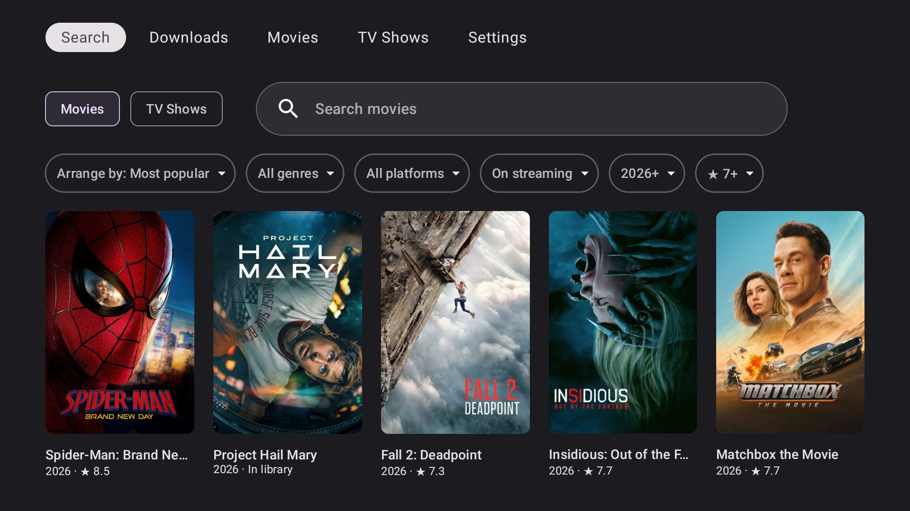

## Features

### Find something new

The **Search** tab opens on the most popular movies or TV shows from TMDB, as a poster grid. Type in the search box to look up any title instead.
Titles that are already in Radarr or Sonarr say "In library".

Dropdowns narrow down the list: arrange by (most popular, top rated, newest, A–Z), genre, streaming platform
(Netflix, Prime Video, Disney+, Apple TV+, HBO Max, Paramount+, Stan, Binge, Hulu, Peacock, Crunchyroll), year, rating,
and whether a movie is on streaming yet. The filters are remembered.

| Filters | TV shows |
|---|---|
| 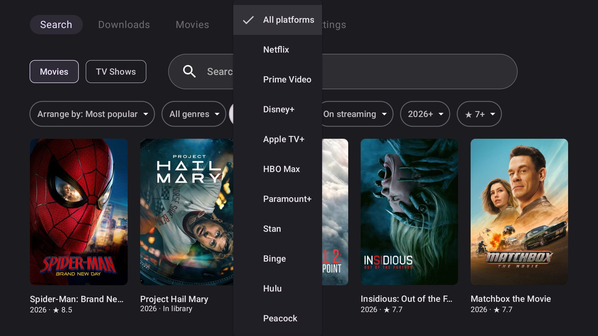 | 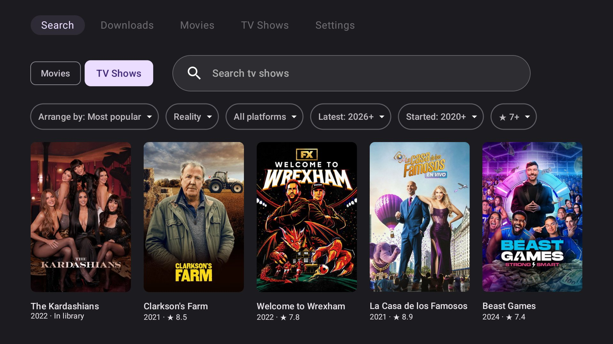 |

### Add a movie or show

Picking a title opens its add page. Choose a quality and add it. Movie pages say whether it's out on streaming yet,
so you know it will actually download. For shows, pick which seasons to download (new seasons are always monitored).
There's also a **Watch trailer** button.

| Movie | Show |
|---|---|
| 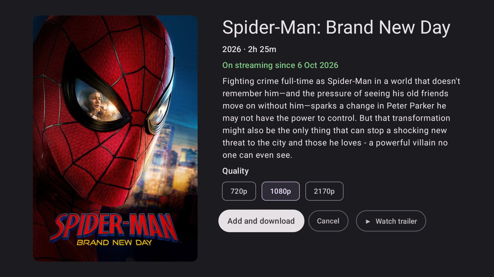 | 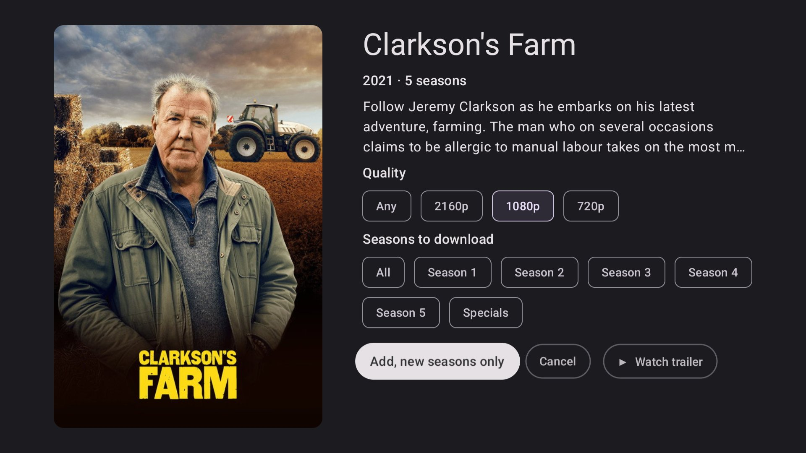 |

### Downloads

The **Downloads** tab shows the Radarr and Sonarr queues together, grouped per download, with progress, size and a plain status
("Downloading", "Can't import", and so on), plus the reason when something is stuck. Stuck downloads can be removed from here.

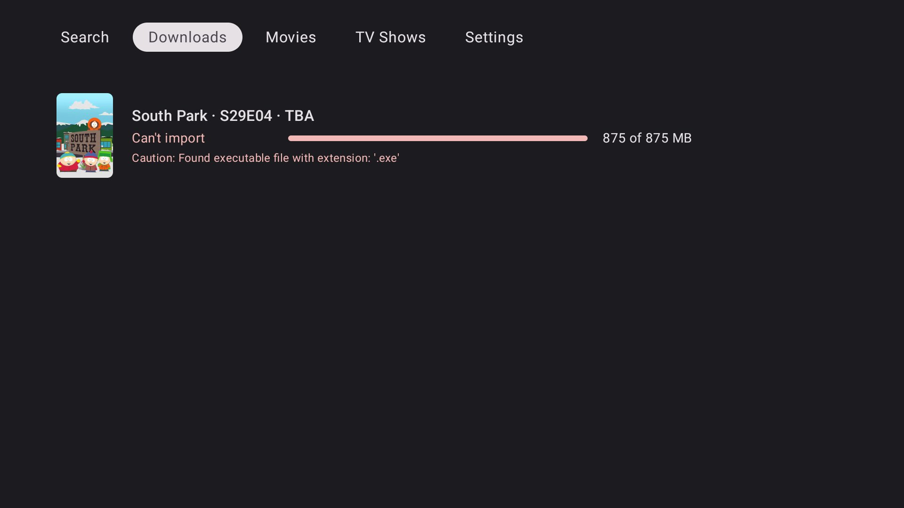

### Your library

The **Movies** and **TV Shows** tabs show everything in Radarr and Sonarr, newest first (like Plex's "recently added").
The search box above each grid filters it as you type.

| Movies | TV Shows |
|---|---|
| 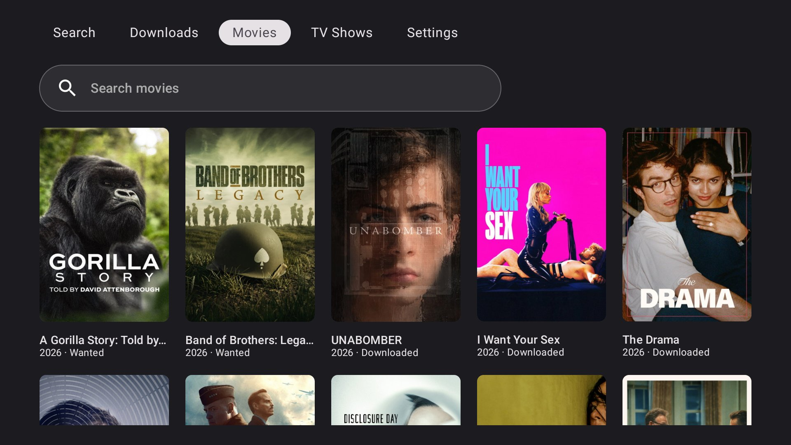 | 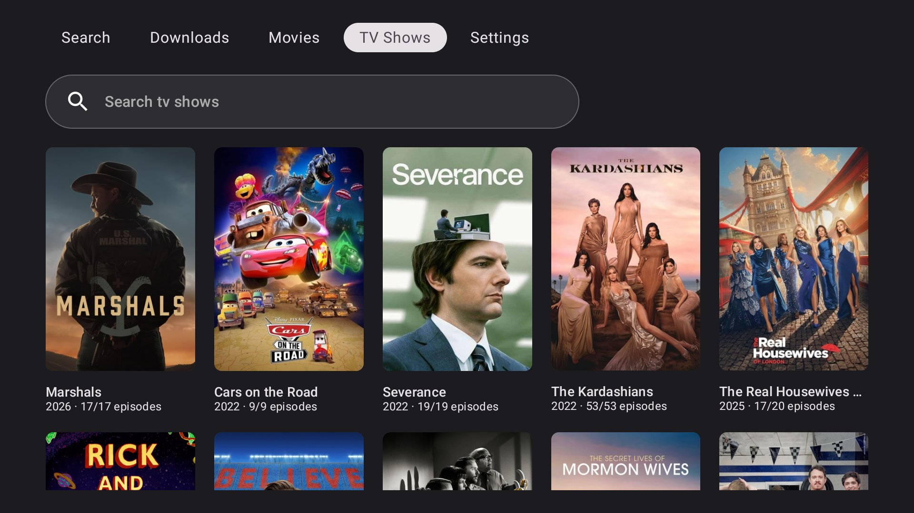 |

### Movie and show pages

Selecting a poster opens its page, with its status, file quality and size, and buttons to search, monitor or unmonitor,
change the quality profile, play the trailer, or delete it.

Show pages have two panes: the show on the left, and its seasons and episodes on the right, each with its own search and
monitoring buttons.

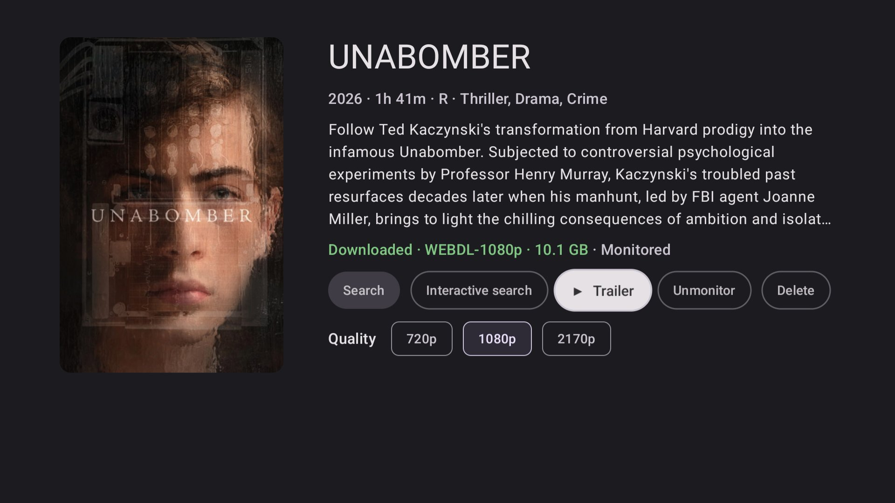

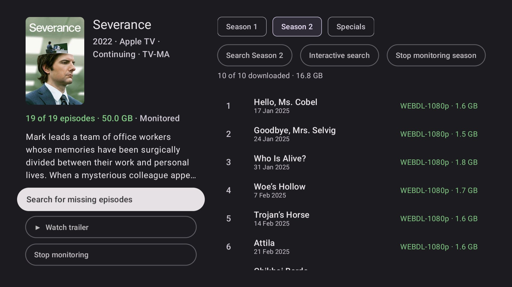

### Interactive search

For when automatic search can't find anything. Like the Radarr and Sonarr web UI, it lists every release the indexers found
for a movie, a season or an episode: name, size and seeders, most seeders first. Releases that Radarr or Sonarr rejected
are in red, with the reason, and can still be downloaded. The app asks before grabbing anything.

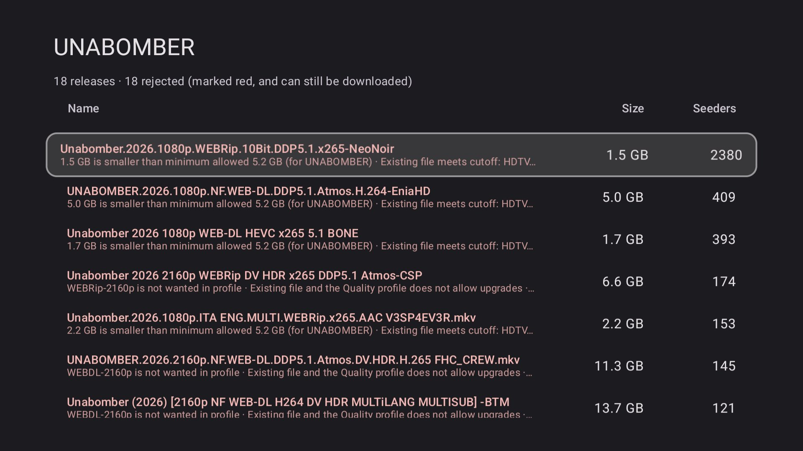

### Trailers

Trailers play inside the app, using YouTube's embedded player. It tries TMDB's official trailers first, then Radarr's,
then a YouTube search. OK pauses, left and right skip 10 seconds, and Back closes it.

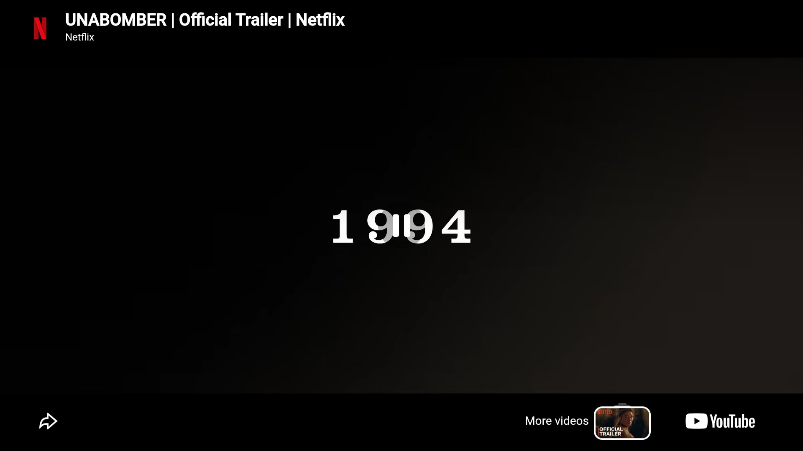

### Settings

The Radarr and Sonarr addresses and API keys, plus a TMDB key for the popular lists on the Search tab.

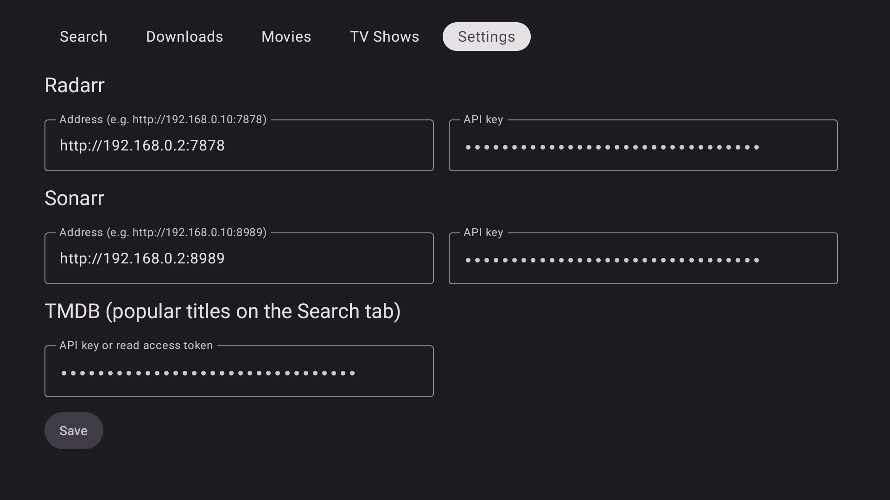

## Building

Requirements: JDK 17 and the Android SDK (compileSdk 34). The app runs on Android 6.0+ (minSdk 23).

```sh
./gradlew assembleRelease
```

This builds `app/build/outputs/apk/release/app-release.apk`. Use the release build: it's minified with R8 and scrolls much more
smoothly than the debug build. It's signed with the debug key, so it installs over either build.

### Optional: built-in defaults

To avoid typing the server details on the TV, put them in `local.properties` (which is gitignored) and they'll be baked into the build:

```properties
arr.radarrUrl=http://192.168.0.10:7878
arr.radarrKey=your-radarr-api-key
arr.sonarrUrl=http://192.168.0.10:8989
arr.sonarrKey=your-sonarr-api-key
arr.tmdbKey=your-tmdb-api-key
```

The Radarr and Sonarr API keys are under Settings → General in their web UIs. A TMDB key is free from
[themoviedb.org](https://www.themoviedb.org/settings/api).

## Installing on the TV

Turn on ADB debugging on the TV (Developer options), then:

```sh
adb connect <tv-ip>:5555
adb install -r app/build/outputs/apk/release/app-release.apk
```

## How it's built

- Kotlin and Jetpack Compose for TV (`androidx.tv:tv-material`)
- Retrofit with kotlinx.serialization for the Radarr and Sonarr v3 APIs (`X-Api-Key` header) and TMDB
- Coil for posters
